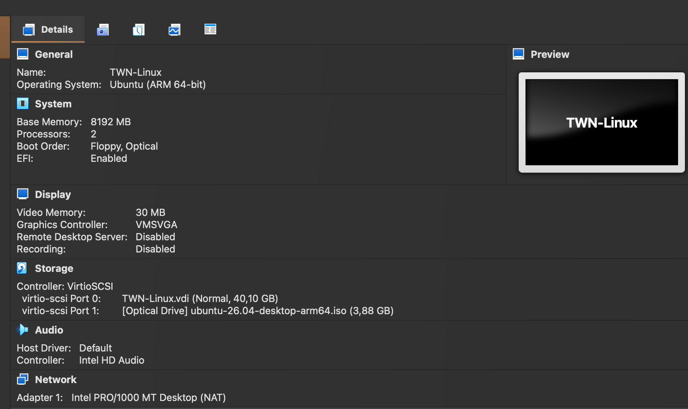

# Module 2 - Linux - Creating a Virtual Machine
As I don't develop with Java in my day-to-day job I decided to create an Ubuntu virtual machine as demoed by Nana. This way I do not have software on my Mac which I won't use after the bootcamp.

I have a personal dotfiles repository using Ansible with which I can quickly configure the machine to my needs.

- Downloaded `ubuntu-26.04-desktop-arm64.iso`
- Created a VM:

