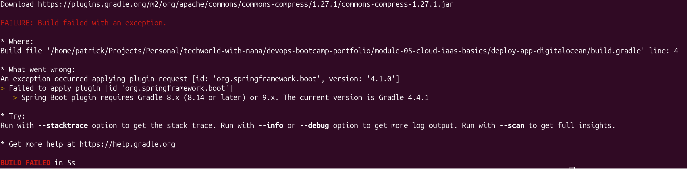
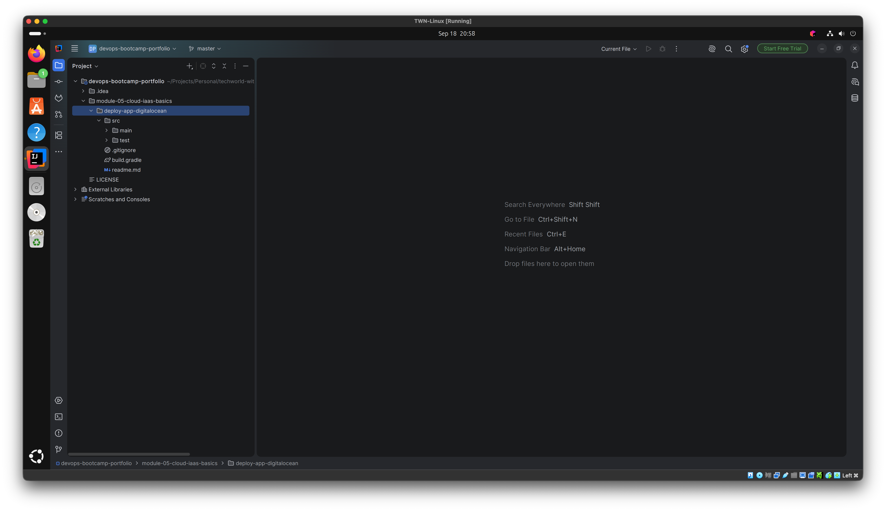
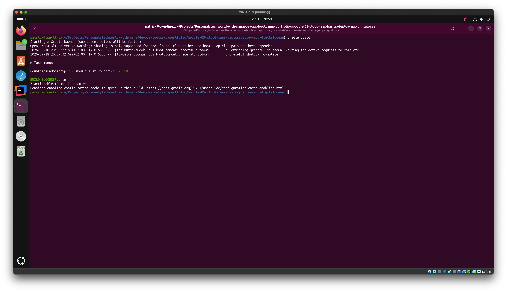
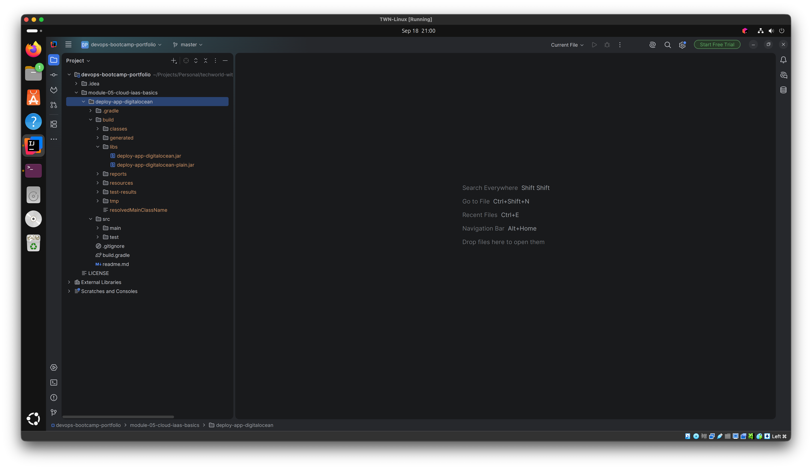
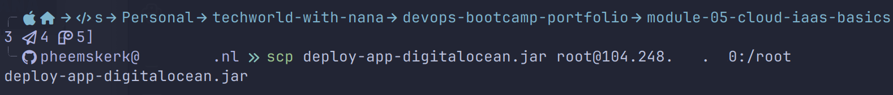
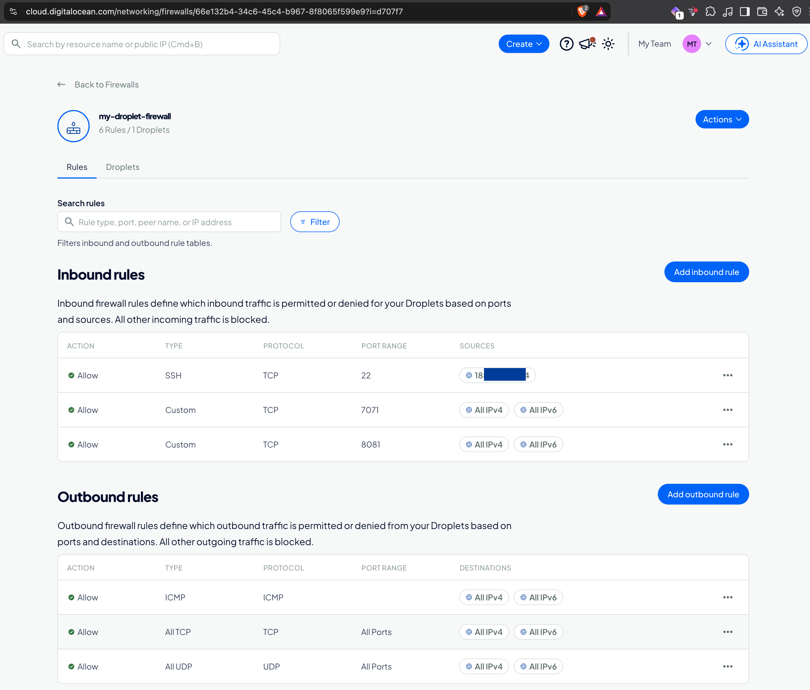
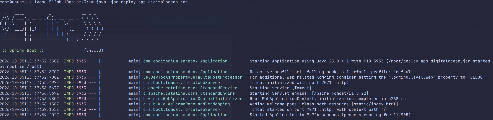
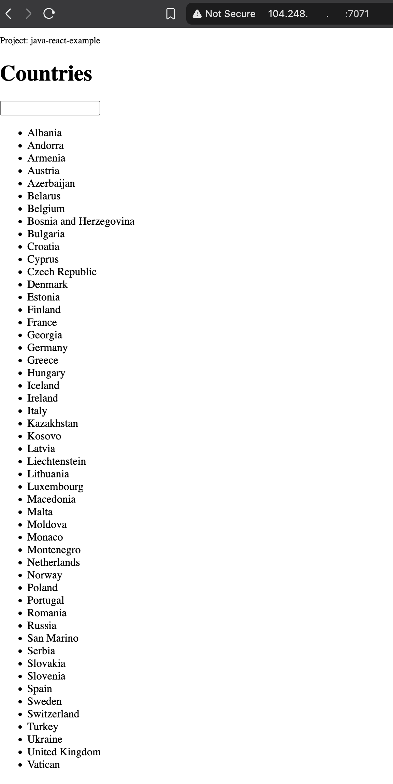

# Module 5 - Cloud & Infrastructure as Service Basics

As you may have read in the [README.md](../README.md) at the root of this repo, I am a dedicated full-stack .NET developer. 
For the past few years, I have been working on macOS rather than Windows. 
Since I don't use Java for anything else, I didn't want to "clutter" my Mac just to run the demo assignments.

## Ubuntu virtual machine
Therefore, I decided to set up an Ubuntu virtual machine in VirtualBox for the relevant modules. Initially, this caused some issues because the M4 uses a silicon chip, which requires a specific version of Ubuntu (ARM 64-bit, AArch64).

To carry out the assignment for Module 5, I cloned this repository inside the VM. Then, within the `deploy-app-digitalocean` folder, I cloned the relevant Java code from the bootcamp GitLab repo: https://gitlab.com/twn-devops-bootcamp/latest/05-cloud/java-react-example

## Troubleshooting

### Gradle version
I ran into a problem when executing `gradle build`: the command `sudo apt-get install gradle` installed a very old version that was incompatible with the installed Java version.



I eventually resolved this by installing [SDKMAN!](https://sdkman.io/). This allowed me to install the latest version of Gradle and build the project.

### Java $PATH

To make sure `gradle` could use the `java` version on the virtual machine, I had to update the environment `$PATH` variable. Therefore, I opened my `~/.bashrc` file and added
```bash
export JAVA_HOME=/usr/lib/jvm/java-25-openjdk-arm64
export PATH=$JAVA_HOME/bin:$PATH
```

## Results

**Before building**

This shows IntelliJ IDEA inside the Ubuntu virtual machine with the cloned GitLab repo. **Before** building there is **no** `.gradle` and **no** `build` folder.


**Building with gradle**

Running the `gradle build` command inside the terminal


**After building**

After the successful build, there are two new folders visible in IntelliJ, the `.gradle` and the `build` output with the application to deploy `deploy-app-digitalocean.jar` (and not the `java-react-example.jar` as in the bootcamp due to cloning into my own folder)



### Deploying to Droplet

Since the jar was built inside the Ubuntu VM, I first copied `deploy-app-digitalocean.jar` from the VM to my Mac. From the macOS terminal I then deployed it to my DigitalOcean Droplet with the `scp` command.



To run the jar, the Droplet needs a Java runtime. Since the app only runs on the server and isn't built there, the headless JRE is enough:
```bash
apt update
apt install openjdk-25-jre-headless
java -version
```

### Adjusted firewall rules

Added a firewall rule to allow traffic on port 7071.

The screenshot also shows port 8081 open. That rule belongs to module 6 (Nexus): I retook the screenshots in light mode after finishing that module, so the firewall already included it.



### Running the jar from command line



### Accessing the jar from the browser


