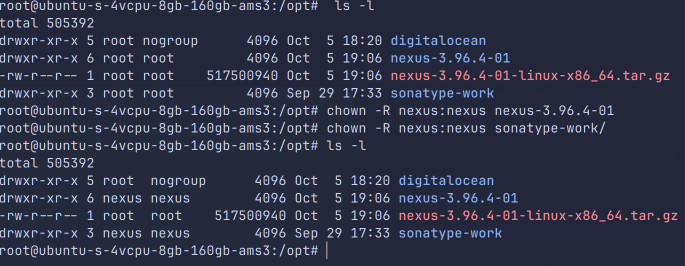
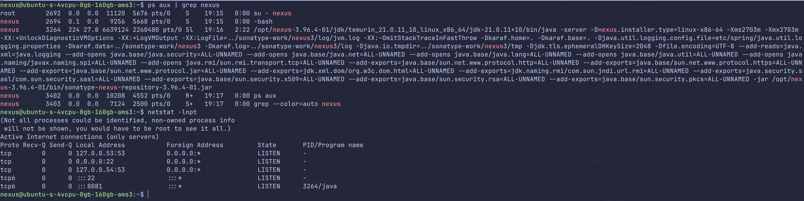
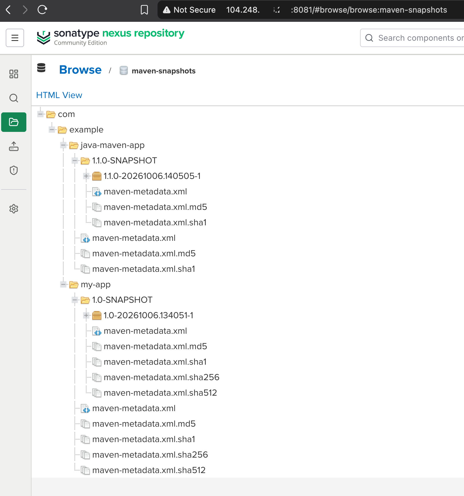
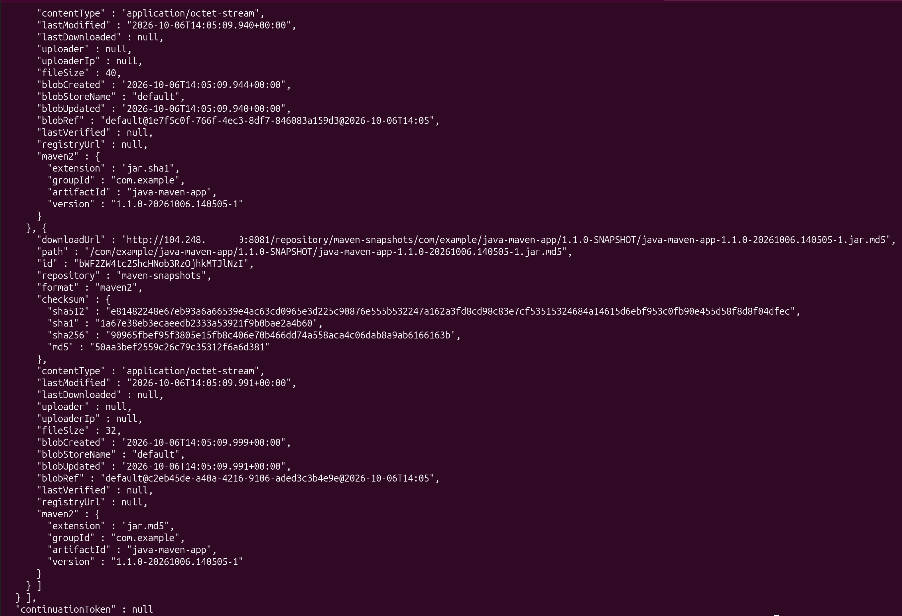
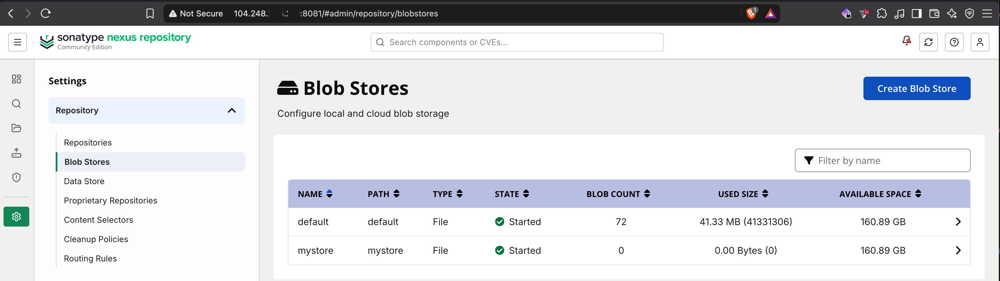
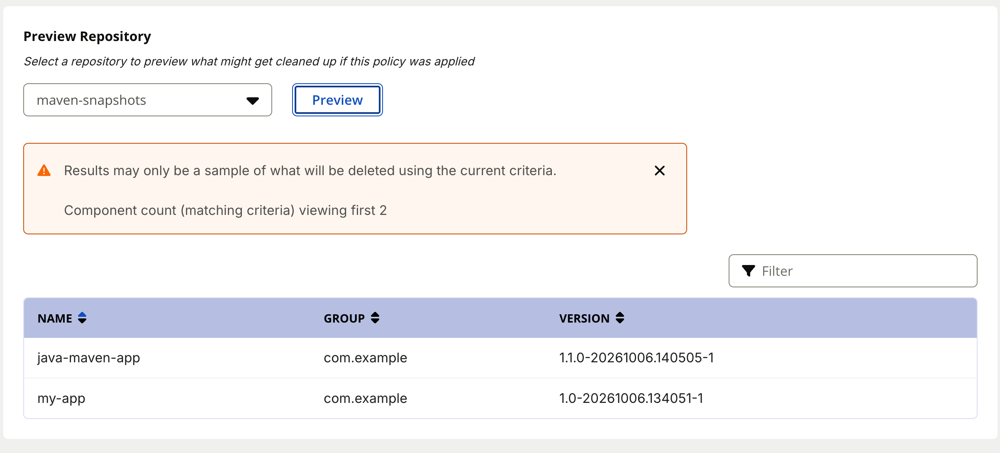
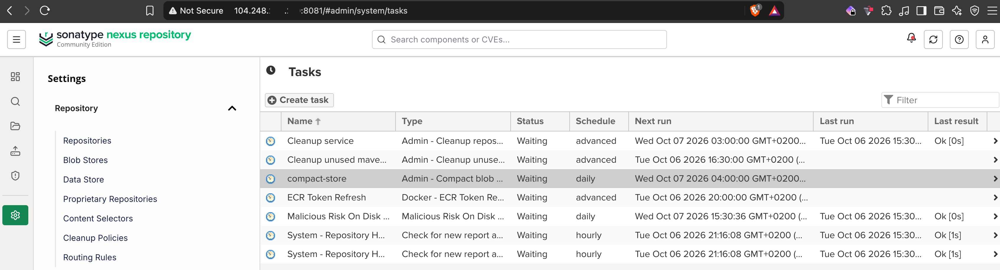
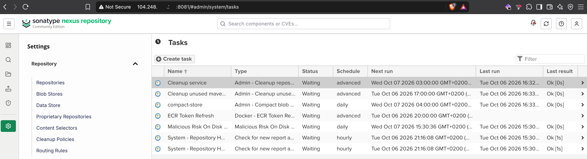

# Module 6 - Artifact Repository Manager with Nexus

## Resized Droplet

For this module, I resized my module 5 Droplet to meet the Nexus requirements, going from `ubuntu-s-1vcpu-512mb-10gb-ams3` to `ubuntu-s-4vcpu-8gb-160gb-ams3`.

## Steps performed in this module
- Installed Nexus on the DigitalOcean Droplet
  - started Nexus with `/opt/nexus-3.96.4-01/bin/nexus start`
- Created a dedicated Linux user `nexus`
- Changed the ownership of the Nexus installation and `sonatype-work` folders to the `nexus` user

- Configured Nexus to run as the `nexus` user (`nexus.rc` file)
- Started Nexus as the `nexus` user

- Configured a firewall rule to open port 8081 to access Nexus from the browser
- Created a Nexus user with a role that is allowed to deploy to the `maven-snapshots` repository

## Build and deploy

The code for both apps is in [nexus-publish-artifact/course-code](nexus-publish-artifact/course-code): a Gradle app and a Maven app.

I cloned the two GitLab repos in my VirtualBox VM and updated the Nexus repository URL in `build.gradle` and `pom.xml`. After building the `.jar` files, I published each of them to the `maven-snapshots` repository.

The Nexus credentials are kept out of the repo:
- **Gradle** reads `repoUser` and `repoPassword` from a local `gradle.properties` file, which is not committed
- **Maven** uses a `<server>` entry with id `nexus-snapshots` in `~/.m2/settings.xml`

## Queried Nexus

From the terminal inside my VirtualBox VM, I queried the Nexus repository with `curl`.

## Blob Store

Added a new blob store in Nexus via the UI.

## Cleanup policy

The last step of this module was to create a new cleanup policy. The `Preview` button shows which components the policy affects.

### Cleanup manually

First, I created a new compact store task.

Then I ran the tasks manually in this order: `Cleanup service` -> `Cleanup unused maven` -> `compact-store`.

