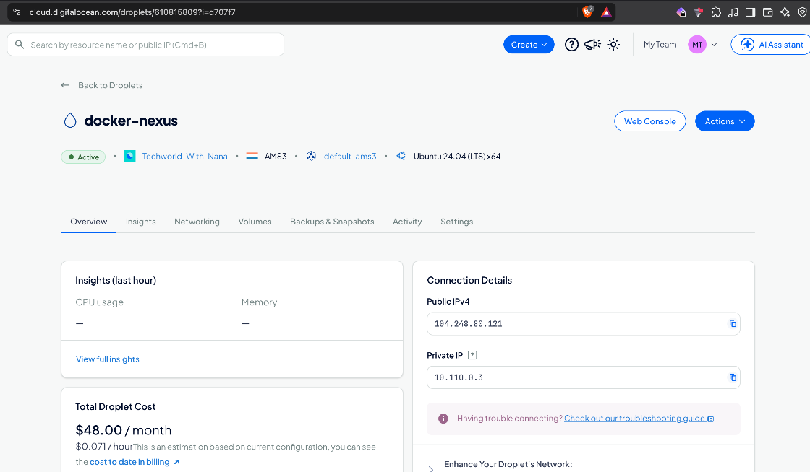
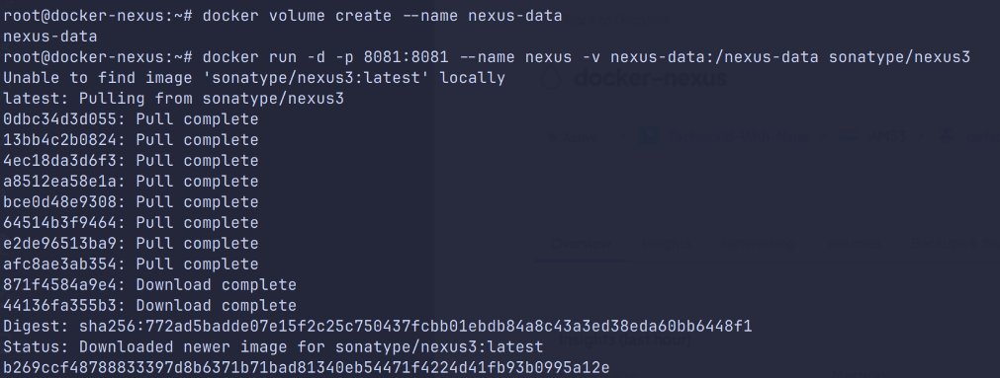
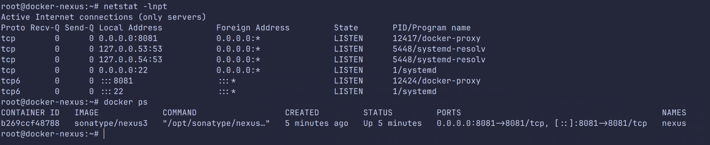
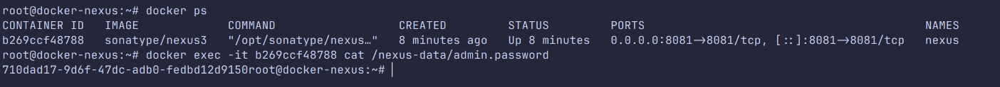
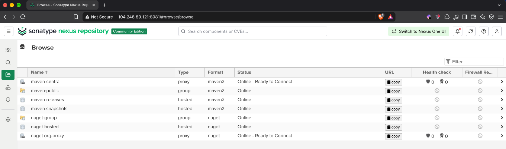
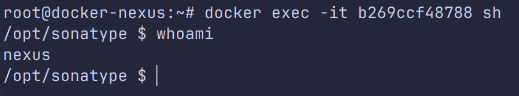
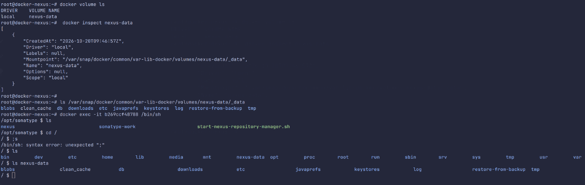

# Deploy Nexus as Docker container

I created a new Droplet (`docker-nexus`) and ran Nexus as a container instead of installing it directly on the server, like in module 6.



I created a named volume first, so the Nexus data survives a container restart or upgrade:

```bash
docker volume create --name nexus-data
docker run -d -p 8081:8081 --name nexus -v nexus-data:/nexus-data sonatype/nexus3
```





The initial admin password is stored inside the volume:





The `sonatype/nexus3` image already runs Nexus as a non-root `nexus` user, so the manual user setup from module 6 isn't needed here.



With `docker volume inspect`, I found where Docker stores the volume on the host (`/var/snap/docker/common/var-lib-docker/volumes/nexus-data/_data`, because Docker was installed via snap).


