# Local development with Docker

The app code is in [course-code/mongo](course-code/mongo), cloned from https://gitlab.com/twn-devops-bootcamp/latest/07-docker/js-app.git.

## Use Docker for local development

### Running a single container
To go through the basic container lifecycle, I ran a Redis container with `docker run -d redis`, then stopped and removed it again with `docker stop` and `docker rm`.

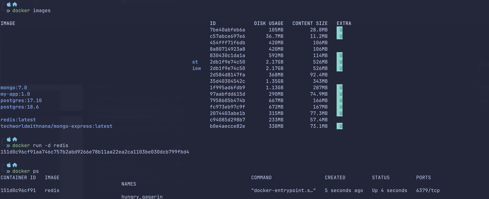

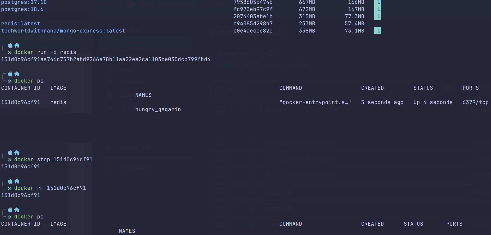

### Multiple versions of Postgres
I created a compose file to have multiple versions of Postgres running next to each other:

**NOTE** I added volumes to this compose file. Starting with Postgres 18, the image stores its data in a versioned subfolder (`/var/lib/postgresql/18/docker`) and the recommended mount point is `/var/lib/postgresql` instead of `/var/lib/postgresql/data`. That's why the volume targets of both services differ.

```yaml
name: techworld-with-nana

services:
  # First PostgreSQL Instance (Version 18.6)
  postgres-18:
    image: postgres:18.6
    container_name: tw-postgres-18
    environment:
      POSTGRES_PASSWORD: mysecretpass
    ports:
      - "5432:5432" # Accessible locally on port 5432
    volumes:
      - "./module-07-containers-docker/postgres-data/pgdata-18:/var/lib/postgresql"

  # Second PostgreSQL Instance (e.g., Version 17.10)
  postgres-17:
    image: postgres:17.10
    container_name: tw-postgres-17
    environment:
      POSTGRES_PASSWORD: myothersecretpass
    ports:
      - "5433:5432" # Accessible locally on port 5433 (avoids conflict)
    volumes:
      - "./module-07-containers-docker/postgres-data/pgdata-17:/var/lib/postgresql/data"
```

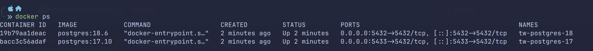

### Running the app with MongoDB
I edited the user profile in the app and checked in Mongo Express that the change was stored in the `user-account` database. `docker logs -f` on the Mongo container showed the incoming connection from the app.

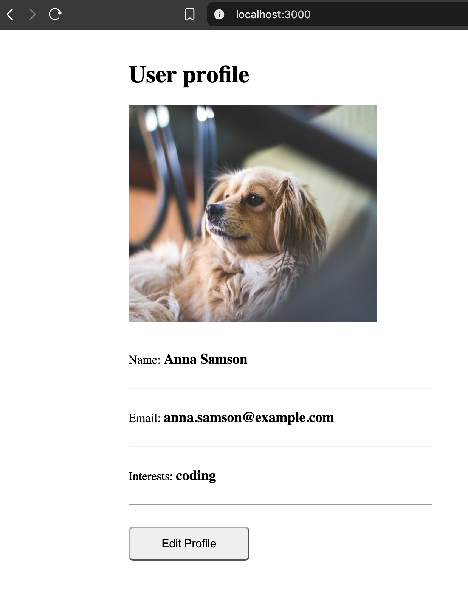

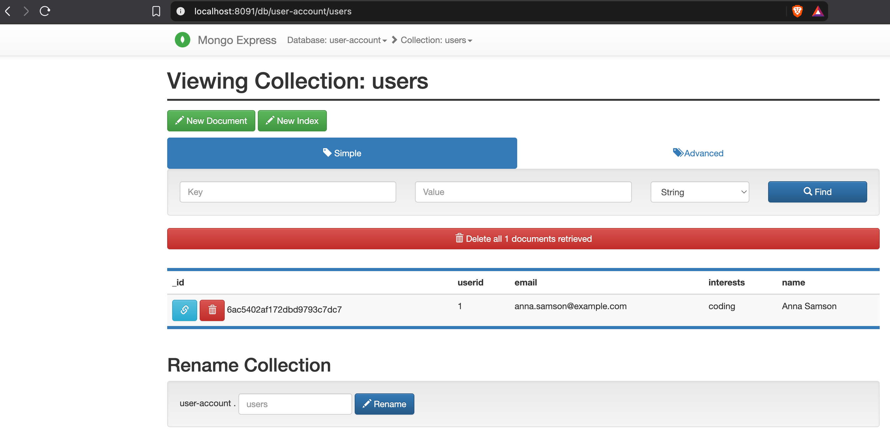

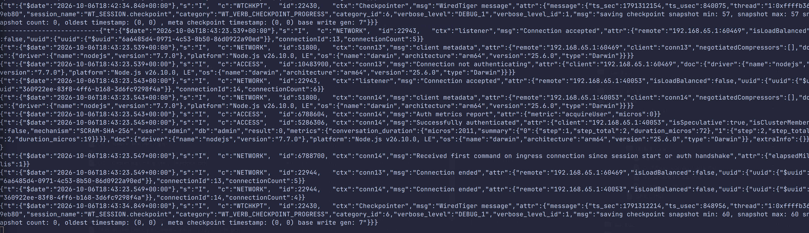

## Docker Compose - Run multiple Docker containers

While trying to run the latest Mongo image on my Mac Mini, I ran into an error. The latest version of MongoDB (`mongo:latest`) conflicts with the newer Linux kernel running inside Docker Desktop for Mac, and MongoDB explicitly blocks itself from booting to prevent corrupted databases.

I fixed this by pinning the image to `mongo:7.0`. Mongo and Mongo Express run in the same [compose file](course-code/mongo/docker-compose.yaml) and talk to each other over a shared network (`tw-network`).

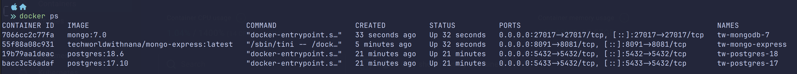

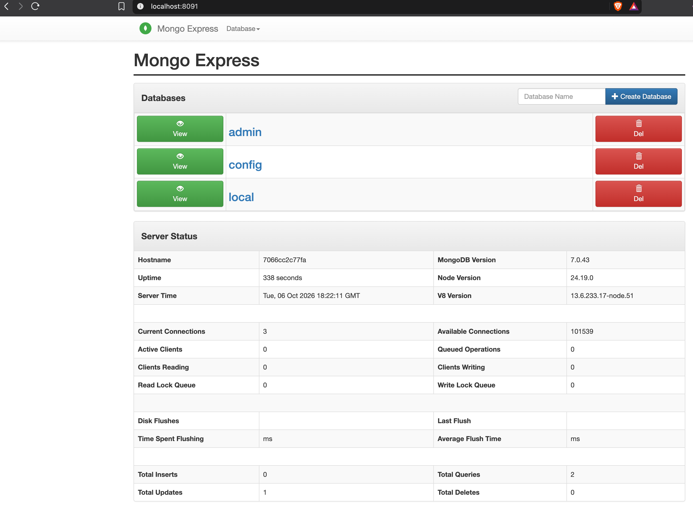

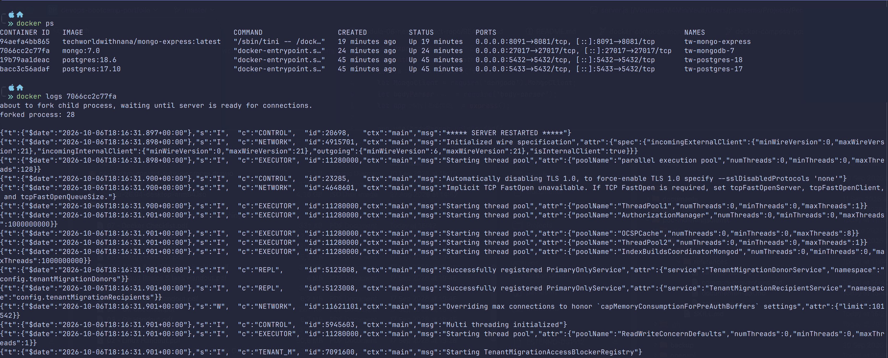

## Dockerize Node.js application

Before creating a Docker image, I had to switch `server.js` from `mongoUrlLocal` to `mongoUrlDockerCompose`. Inside the compose network, the app container reaches MongoDB by its service name (`mongodb`) instead of `localhost`, since `localhost` inside a container points to the container itself.

I then built the image with `docker build -t my-app:1.0 .`

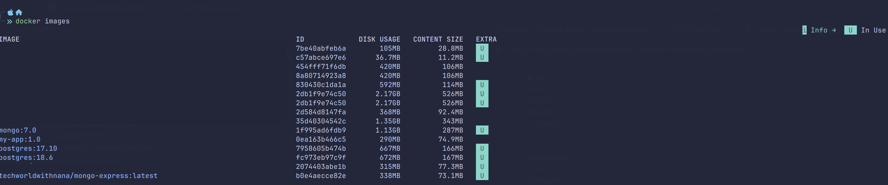

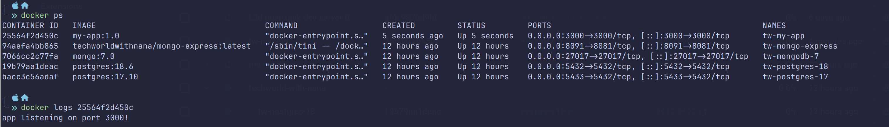

To check the result, I opened a shell inside the running container. The app files are in `/home/app`, and the Mongo credentials are passed in as environment variables.

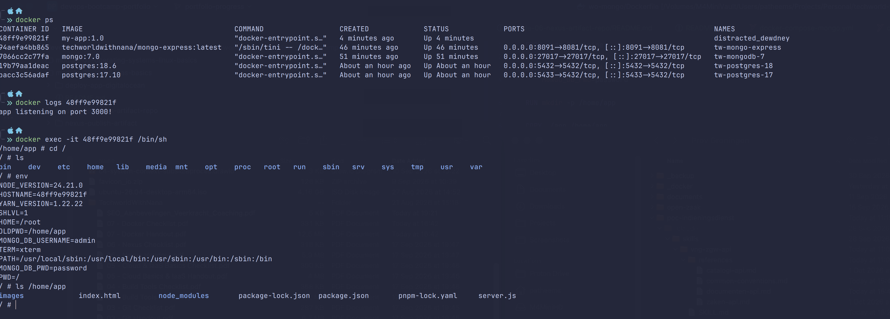

## Persist data with Docker Volumes

The Mongo data is stored in a volume mounted on `/data/db`, so the user data survives removing and recreating the containers.

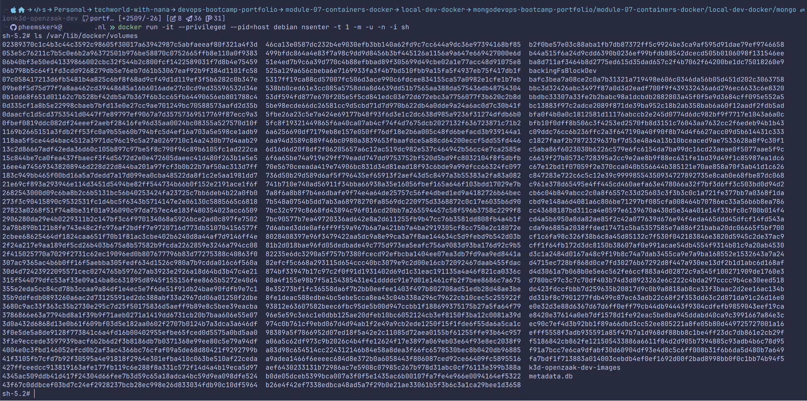

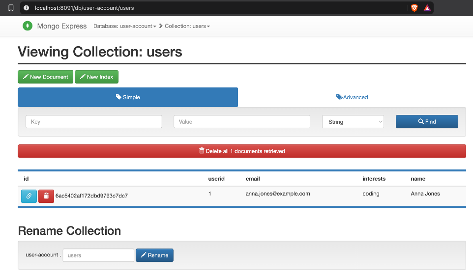

## Deploy Docker application on a server with Docker Compose

After pushing `my-app` to my private Nexus registry (see [nexus-docker-repo](../nexus-docker-repo/README.md)), I deployed the whole stack to the Droplet:

1. Allowed the HTTP registry on the Droplet by adding it to `insecure-registries` in Docker's `daemon.json` and restarting Docker. The file doesn't exist by default, so I created it
2. Installed the Docker Compose plugin (`apt install docker-compose-v2`).
3. Copied the [compose file](course-code/mongo/docker-compose.yaml) to the Droplet with `scp`
4. Logged in to the registry with `docker login <nexus-host>:8083`
5. Started the stack, passing the registry address inline instead of using a `.env` file:

```bash
DOCKER_REGISTRY="<nexus-host>:8083" docker compose up -d
```

### Wrong platform
The first attempt failed on pulling `my-app`:

```
no matching manifest for linux/amd64 in the manifest list entries
```

I built the first image on my M4 Mac, so it only existed for `linux/arm64`, while the Droplet runs on `linux/amd64`. I rebuilt it as a multi-platform image, so the same tag works on both my Mac and the Droplet:

```bash
docker build --platform linux/amd64,linux/arm64 -t <nexus-host>:8083/my-app:1.0 .
docker push <nexus-host>:8083/my-app:1.0
```

After that, all three containers started on the Droplet:

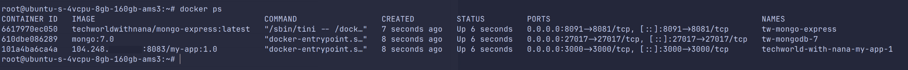

### Frontend calling localhost
The containers were running, but the frontend in `index.html` fetched its data from a hardcoded URL:

```js
fetch('http://localhost:3000/get-profile')
```

See also the original GitLab source `https://gitlab.com/twn-devops-bootcamp/latest/07-docker/js-app/-/blob/master/app/index.html?ref_type=heads#L46`

`index.html` runs in the browser, so `localhost` points to my own machine, not to the Droplet. Locally this goes unnoticed, and it even gives a false positive when the app also runs on my Mac, because the page then shows data from my local MongoDB. I changed both calls to relative URLs, so the browser calls the host that served the page:

```js
fetch('/get-profile')
fetch('/update-profile', { ... })
```

I pushed this as `my-app:1.1`, updated the tag in the compose file and deployed again:

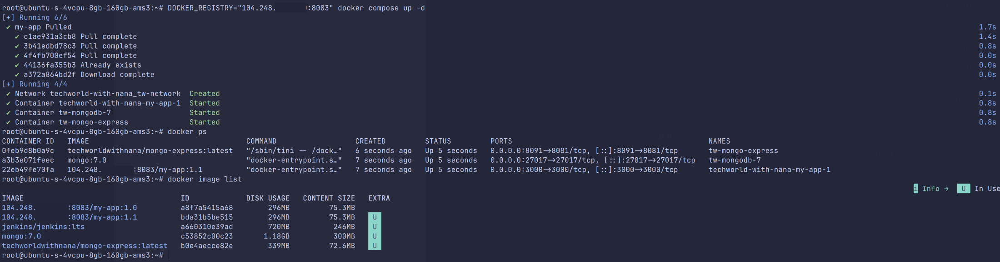

The app now loads its data from the MongoDB container on the Droplet:

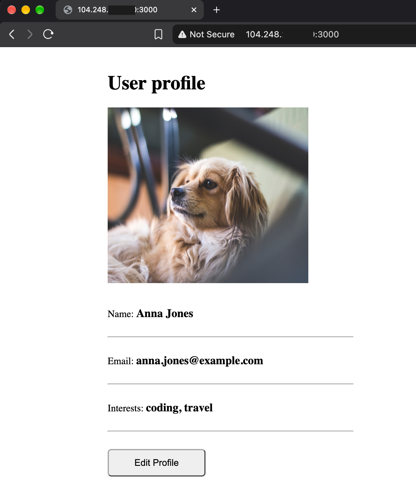
