# Private Docker repository on Nexus

For this part, I reused the Nexus instance from module 6.

## Create Docker repository on Nexus and push to it

### Create the Docker hosted repository
- Created a `docker-hosted` repository in Nexus

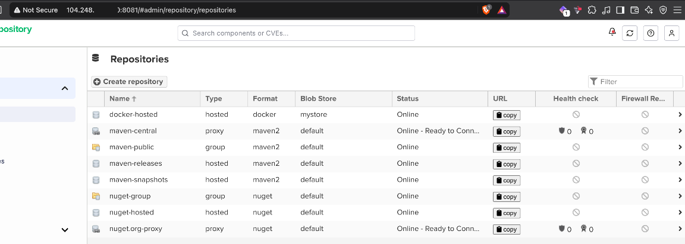

- Configured an HTTP connector on port 8083 for the repository. The Docker client talks to this port directly, not to the Nexus UI on 8081

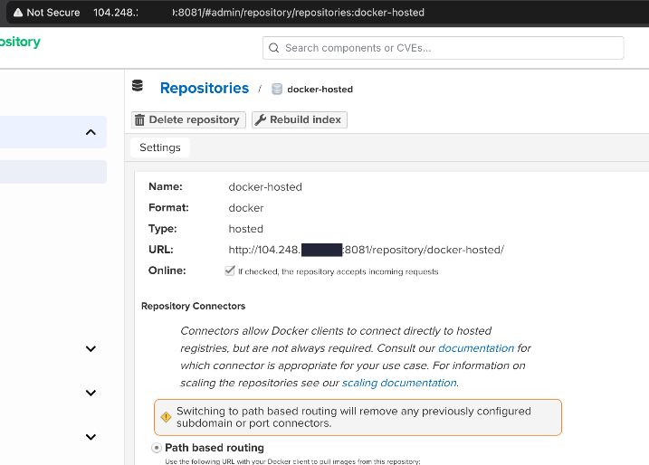

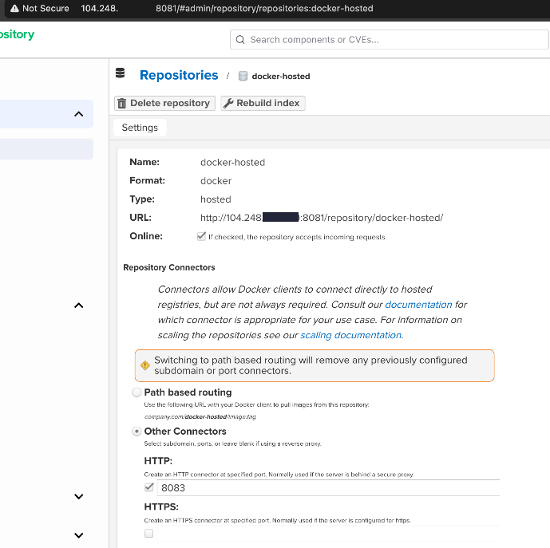

- Created an `nx-docker` role with access to the Docker repository and assigned it to my Nexus user

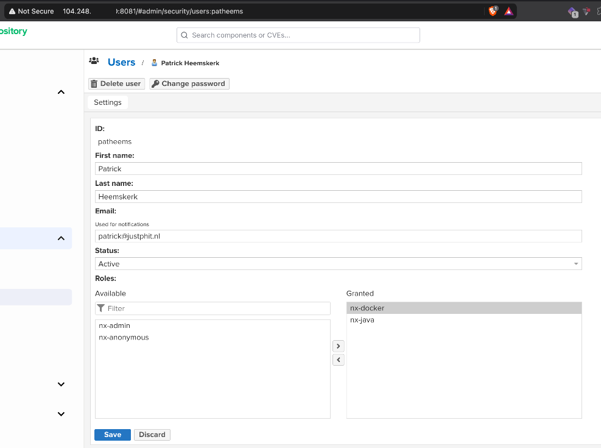

- Activated the **Docker Bearer Token Realm**, which `docker login` needs to get a token from Nexus

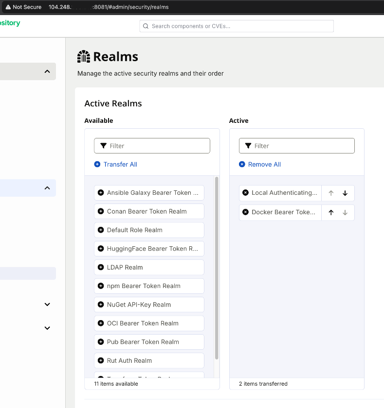

- Opened port 8083 in the DigitalOcean firewall

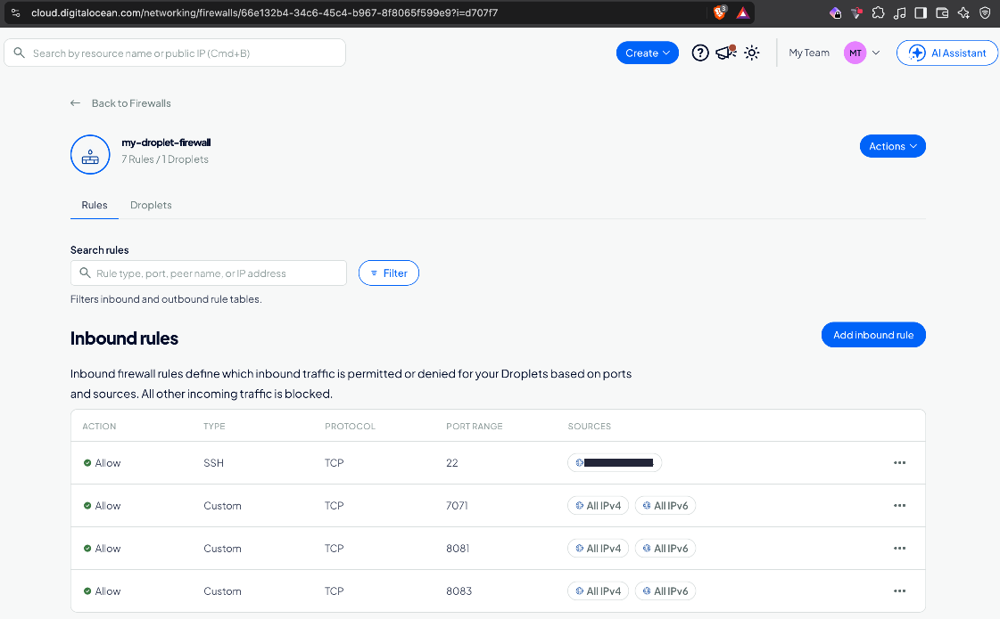

Nexus now listens on both 8081 and 8083:

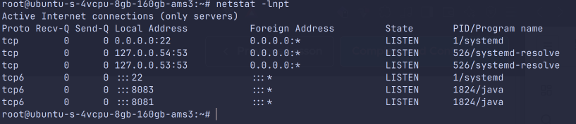

### Log in and push
The registry runs on plain HTTP, so I added it to `insecure-registries` in the Docker Desktop engine settings. Otherwise, Docker refuses to connect to it.

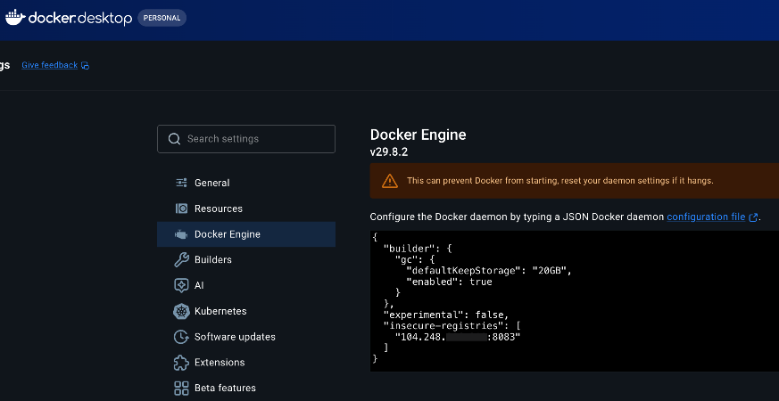

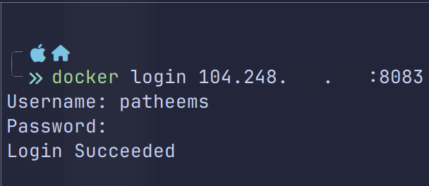

To push the image to Nexus, it needs a tag that includes the registry address:

```bash
docker tag my-app:1.0 <nexus-host>:8083/my-app:1.0
docker push <nexus-host>:8083/my-app:1.0
```

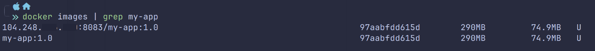

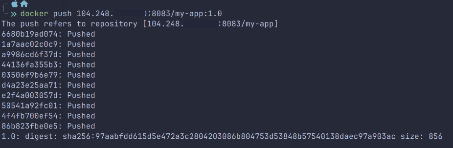

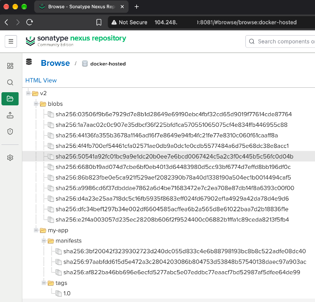

I verified the upload with the Nexus REST API:

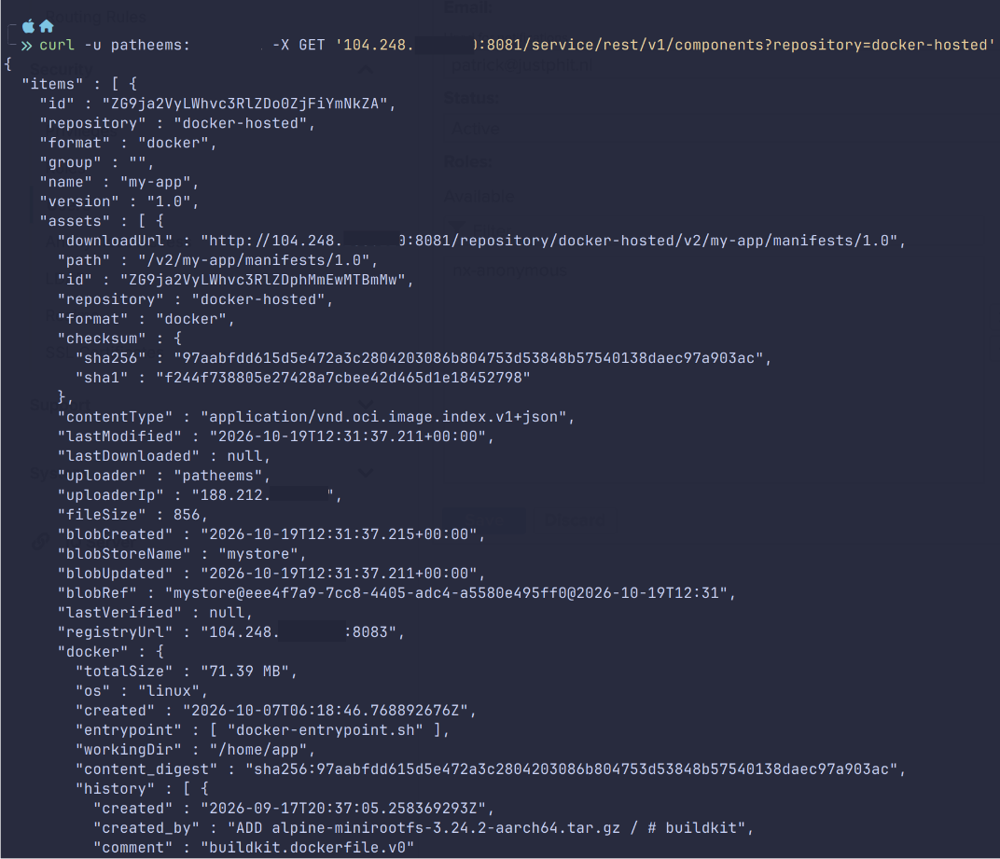

### Pull the image back from Nexus

I changed the `my-app` service in the [compose file](../local-dev-docker/course-code/mongo/docker-compose.yaml) to use the image from Nexus. The registry address comes from a `DOCKER_REGISTRY` variable in a local `.env` file, which is not committed:

```yaml
my-app:
  image: ${DOCKER_REGISTRY}/my-app:1.0
```

Running `docker compose up` on my Mac pulled the app image from the private Nexus registry and started it together with MongoDB and Mongo Express. The deployment to the Droplet is described in [local-dev-docker](../local-dev-docker/README.md#deploy-docker-application-on-a-server-with-docker-compose).

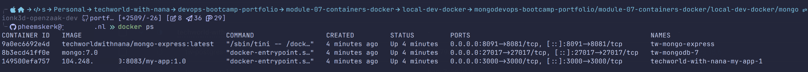
